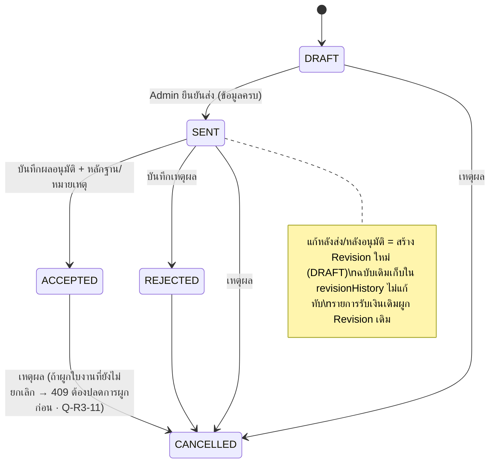
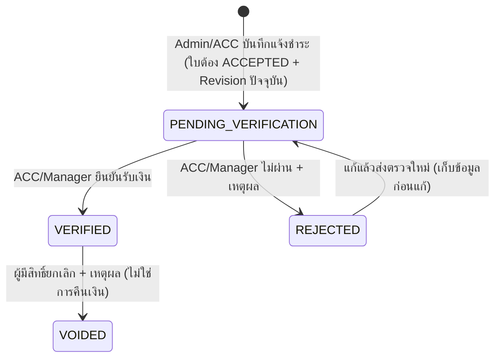

# D-11 Financial Workflow — สถานะ สิทธิ์ และหลักฐาน FIN-01..12

อ้างอิง: "WOMS — Workflow และ State การเงิน v1.0 (30 ต.ค. 2569)" (อนุมัติโดยเจ้าของโครงการ 30 ต.ค. 69) · โค้ด: backend `src/domain/finance.ts`, `src/domain/quotation.ts`, `src/routes/finance.ts`, `src/routes/quotations.ts` · frontend `/finance`, `/finance/queue`, `/finance/audit`, หน้ารายละเอียดใบเสนอราคา (แท็บ ใบเสนอราคา / ผลอนุมัติ / รายการรับเงิน / เอกสารบัญชี / ประวัติ), การ์ดการเงินในหน้าใบงาน

ขอบเขต: ใบเสนอราคา → ลูกค้าอนุมัติ → แจ้งชำระ → ACC ตรวจสอบ → บันทึกเอกสารบัญชีภายนอก · WOMS ไม่ออกใบกำกับภาษี/ใบเสร็จ · ไม่รวมการวางบิลช่าง

## 1. สถานะ (แยกกัน 4 ชุด + ใบงาน/สัญญา/กรรมสิทธิ์ไม่ถูกแตะ)

### 1.1 ใบเสนอราคา

EXPIRED: คงไว้ให้อ่านข้อมูลเดิม เข้าใหม่ไม่ได้ · เสนอใหม่หลังปฏิเสธ = สร้าง Revision

### 1.2 รายการรับเงินแต่ละครั้ง (หลายรายการต่อใบ · หลักฐานหลายไฟล์)

ห้ามแก้ยอดที่ VERIFIED โดยตรง — ยกเลิกแล้วสร้างรายการใหม่ · ส่งซ้ำด้วย idempotency key เดิม = ได้รายการเดิม · ยืนยันพร้อมกันสำเร็จครั้งเดียว (เขียนแบบมีเงื่อนไขสถานะ)

### 1.3 สถานะรับชำระรวม (คำนวณ ไม่มีให้ผู้ใช้เลือก)
| สถานะ | เงื่อนไข |
|---|---|
| UNPAID | ยอดยืนยัน = 0 |
| PARTIALLY_PAID | 0 < ยอดยืนยัน < ยอดที่ต้องชำระ |
| PAID | ยอดยืนยัน ≥ ยอดที่ต้องชำระ |
ยอดยืนยัน = ผลรวม VERIFIED (ทุก Revision ของใบ) · คงเหลือ = ยอดที่ต้องชำระ (Revision ปัจจุบัน) − ยอดยืนยัน · มีรายการรอตรวจ → ป้าย "· มีรายการรอตรวจสอบ" ยอดไม่เปลี่ยน · รับเกิน / ยอดเป็นศูนย์ / มีเงินบน Revision เก่า / เงินบนใบที่ยกเลิก → ธงข้อยกเว้นให้ตรวจ ไม่ปรับยอดเอง (PDF อ้างหัวข้อ 10 ที่ไม่มีในเอกสาร)

### 1.4 เอกสารบัญชีภายนอก
PENDING (ยังไม่บันทึก) → RECORDED (ประเภท เลขที่ วันที่ ไฟล์ รายการรับเงินที่เกี่ยวข้อง) · การส่งลูกค้าบันทึกแยก (ส่งแล้ว วันที่ ช่องทาง ผู้บันทึก) · บันทึกเอกสารไม่ยืนยันเงินและไม่เปลี่ยนสถานะรับชำระ · เลขเอกสาร+ประเภทซ้ำข้ามใบเสนอราคาไม่ได้ (เทียบหลัง normalize)

## 2. ตารางสิทธิ์ (backend RBAC — ตรวจด้วย api-qa-fin / security)

| การดำเนินการ | Admin | ACC | Manager | CEO | Sale | ช่าง | Viewer |
|---|---|---|---|---|---|---|---|
| ดูรายการ/รายละเอียด/ส่งออก/ไฟล์/สรุปการเงินใบงาน (`finance:view`) | ✓ | ✓ | ✓ | ✓ (อ่านอย่างเดียว) | ✗ | ✗ | ✗ |
| สร้าง/แก้/ส่ง/บันทึกผลอนุมัติใบเสนอราคา | ✓ | ✗ | ✓ | ✗ | ✗ | ✗ | ✗ |
| บันทึกแจ้งชำระ + หลักฐาน / ส่งตรวจใหม่ (`payments:record`) | ✓ | ✓ | ✓ | ✗ | ✗ | ✗ | ✗ |
| ยืนยัน / ไม่ผ่าน (`payments:verify`) | ✗ | ✓ | ✓ | ✗ | ✗ | ✗ | ✗ |
| ยกเลิกรายการที่ยืนยันแล้ว (`payments:void`) | ✗ | ✓ | ✓ | ✗ | ✗ | ✗ | ✗ |
| บันทึกเอกสารบัญชี + การส่งลูกค้า (`accounting_docs:record`) | ✓ | ✓ | ✓ | ✗ | ✗ | ✗ | ✗ |
| ปลดการผูกใบเสนอราคากับใบงาน (Q-R3-11) | คำขออนุมัติ → Manager | ✗ | ✓ | ✗ | ✗ | ✗ | ✗ |
ACC ไม่มีสิทธิ์ใบงาน สต๊อก ผู้ใช้ ข้อมูลหลัก ต้นทุนอะไหล่ หรือ Activity Log ทั้งบริษัท (DEC-01) · Sale ไม่เห็นรายรับ/ยอดเงิน (D-22 Option A)

**ยังไม่ได้กำหนด (เรื่องรอตัดสินใจ):** ผู้บันทึกแจ้งชำระกับผู้ยืนยันเป็นคนเดียวกันได้ (ADV4-11 maker-checker) · ยกเลิก/แก้เอกสารบัญชีที่บันทึกผิดไม่ได้ (spec ไม่มีขั้นตอน)

## 3. การแจ้งเตือน (ภายใน WOMS เท่านั้น)
แจ้งชำระใหม่ → ACC/ผู้มีสิทธิ์ตรวจ · ตรวจผ่าน → Admin ผู้รับผิดชอบ (ผู้สร้างใบ; ไม่มี → Admin ทุกคน) · ไม่ผ่าน → ผู้บันทึก + Admin ผู้รับผิดชอบ · ยกเลิก → Admin ผู้รับผิดชอบ + ACC · เอกสารพร้อมส่ง → Admin ผู้รับผิดชอบ

## 4. กฎความปลอดภัยทางการเงิน
ไม่ปิดงานจากการรับเงิน · ไม่โอนกรรมสิทธิ์อัตโนมัติ · ไม่บังคับชำระก่อนเปิด JN · ไม่คืนเงินอัตโนมัติ · ไม่ตัดยอดเงียบ · ยกเลิกใบที่มีเงินแล้วไม่ยกเลิกรายการรับเงิน

## 5. FIN-01..12 → หลักฐาน (ชุด `api-qa-fin.mjs` บน API + MongoDB จริง · `e2e-fin.mjs` Chromium · ผลใน 08)
| รหัส | กรณี | ผลที่ต้องได้ | Test |
|---|---|---|---|
| FIN-01 | ส่งใบเสนอราคาและบันทึกอนุมัติ | สถานะถูกต้องและมี Log | api-qa-fin FIN-01 · e2e-fin |
| FIN-02 | แจ้งชำระแต่ยังไม่ตรวจ | แสดงรอตรวจ ยอดยืนยันไม่เพิ่ม | FIN-02 |
| FIN-03 | ยอด 10,000 ตรวจผ่าน 3,000 | ชำระบางส่วน คงเหลือ 7,000 | FIN-03 · e2e-fin |
| FIN-04 | ตรวจผ่านเพิ่ม 7,000 | ชำระครบ คงเหลือ 0 | FIN-04 |
| FIN-05 | ACC ปฏิเสธ | ไม่เพิ่มยอด แสดงเหตุผล | FIN-05 |
| FIN-06 | ยกเลิกรายการที่บันทึกผิด | คำนวณใหม่ เก็บประวัติ | FIN-06 |
| FIN-07 | ผู้ไม่มีสิทธิ์ยืนยันเงิน | ระบบไม่อนุญาต (Admin/Sale/ช่าง/CEO/Viewer/ไม่ล็อกอิน) | FIN-07 |
| FIN-08 | แนบใบเสร็จโดยยังไม่ยืนยันเงิน | สถานะรับชำระไม่เปลี่ยน | FIN-08 |
| FIN-09 | ยืนยันซ้ำ/พร้อมกัน (8 คำขอ) | ยอดเพิ่มครั้งเดียว | FIN-09 |
| FIN-10 | แก้ใบหลังอนุมัติ | Revision ใหม่ ไม่แก้ทับฉบับเดิม | FIN-10 |
| FIN-11 | เปิดดูใบงานที่เกี่ยวข้อง | เห็นสถานะการเงิน สถานะงานไม่เปลี่ยน | FIN-11 |
| FIN-12 | แบ่งชำระและแนบเอกสารหลายครั้ง | เอกสารอ้างอิงรายการรับเงินถูกต้อง | FIN-12 |
เพิ่มเติม: security/negative (Sale/ช่าง/Viewer 403 ทุก endpoint รวม export/PDF/ไฟล์ · IDOR · idempotency · ยอด 0/ติดลบ/ทศนิยมเกิน · รับเกิน · ส่งตรวจใหม่ · ยกเลิกใบที่มีเงิน · Q-R3-11) + R4/R5 (ADV4-02/07/08/09/12, ADV5-04/06/07)
